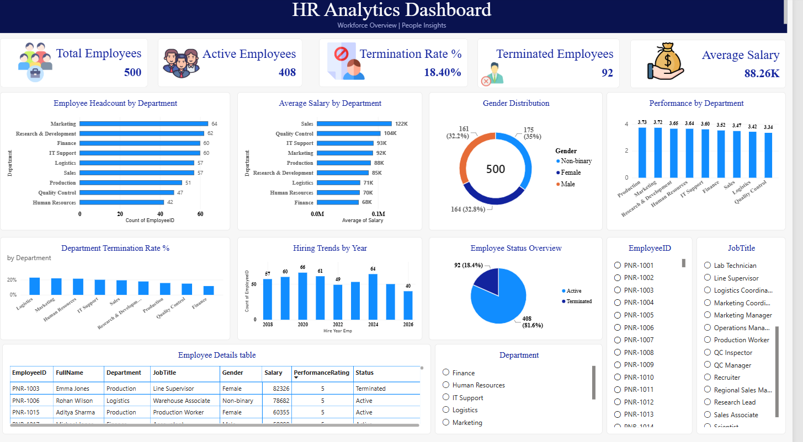

# HR Analytics End-to-End Project | SQL, Python & Power BI

## Project Overview
This project analyzes employee workforce data to understand employee attrition, workforce distribution, salary trends, and performance. It demonstrates an end-to-end data analytics workflow using SQL, Python, and Power BI.

## Business Objectives
- Analyze workforce composition and employee attrition.
- Compare headcount and average salary across departments.
- Explore employee performance ratings and workforce demographics.
- Present key HR metrics through an interactive Power BI dashboard.
- Provide data-driven recommendations to support HR decision-making.

## Tools & Technologies
- **SQL:** Data querying and HR metrics analysis.
- **Python:** Pandas, NumPy, Matplotlib, and Seaborn for analysis and visualization.
- **Power BI:** Interactive dashboard and KPI reporting.
- **Excel:** HR KPI summary and reporting.

## Project Workflow
1. Explore and analyze employee data using SQL.
2. Perform data analysis and create visualizations using Python.
3. Develop an interactive HR dashboard using Power BI.
4. Summarize findings and recommendations for HR decision-making.

## Key Findings
The Python analysis identified 408 active employees and 92 terminated employees among 500 employee records, representing an 18.4% termination proportion in this practice dataset.

## Business Recommendations
- Investigate the factors associated with employee terminations.
- Compare attrition patterns across departments and employee groups.
- Review salary distribution and performance trends to identify areas for further investigation.
- Monitor workforce KPIs regularly to support HR planning and retention strategies.

## Dashboard Preview

## Repository Contents
- `HR_Analytics_SQL_Project.sql` — SQL analysis.
- `HR_Analytics_Python_Project (1).ipynb` — Python analysis notebook.
- `HR_Analytics_KPI_Summary.xlsx` — HR KPI summary.
- `HR_Dashboard.png` — Power BI dashboard preview.
- `HR-Analytics-PowerBI-Dashboard/` — Power BI project folder.

## Disclaimer
This project uses a practice dataset for educational and portfolio purposes. Findings are illustrative and should not be interpreted as actual company workforce statistics.
